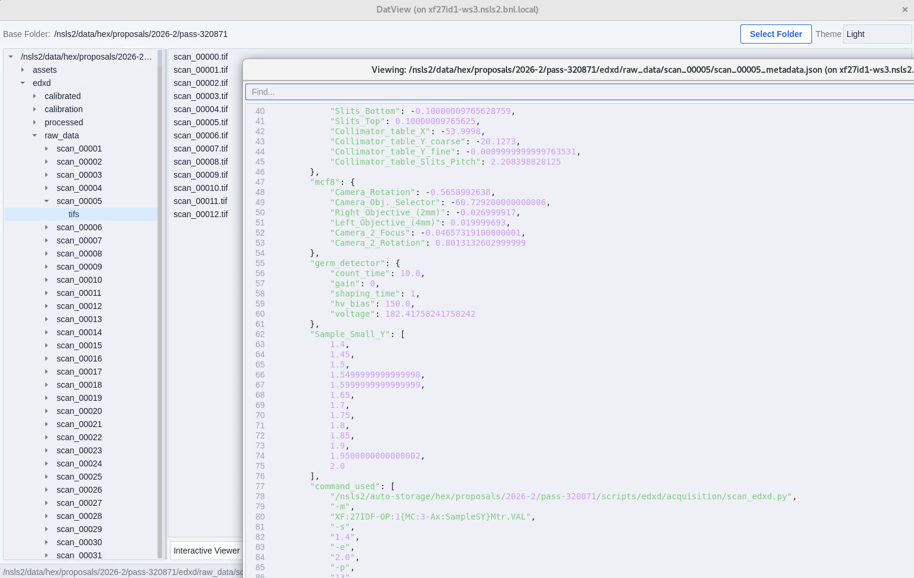
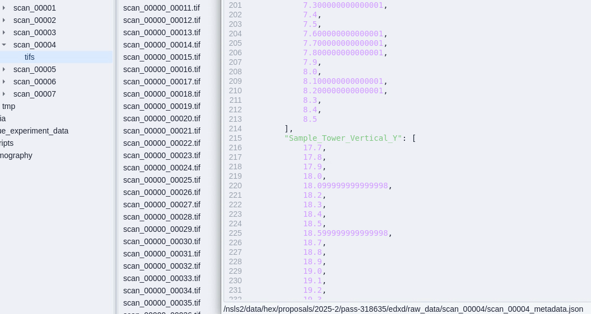
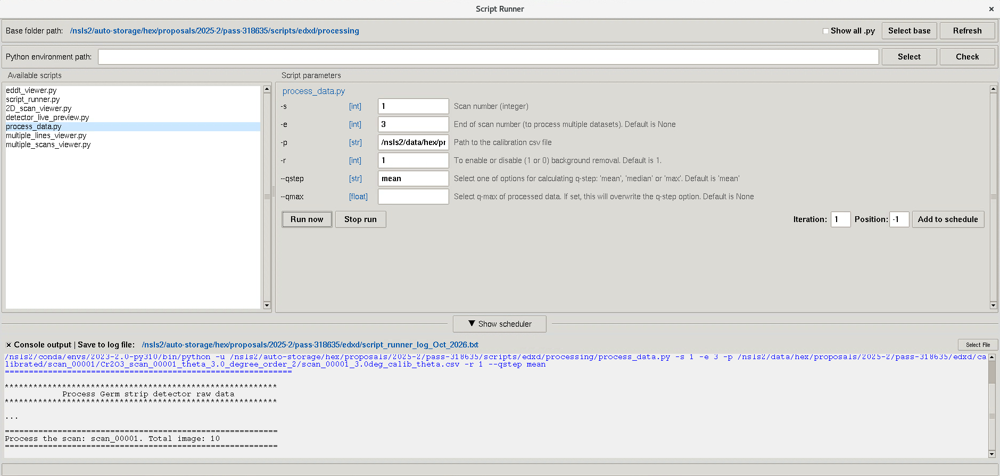
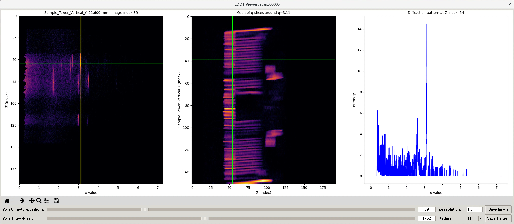
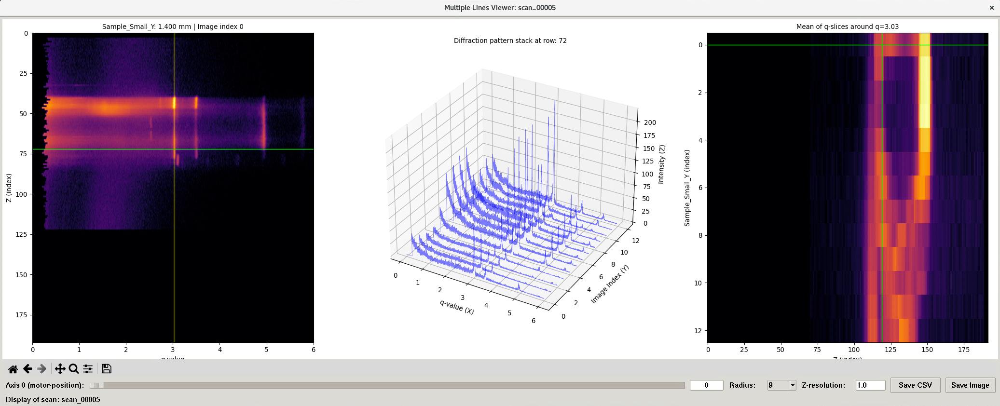
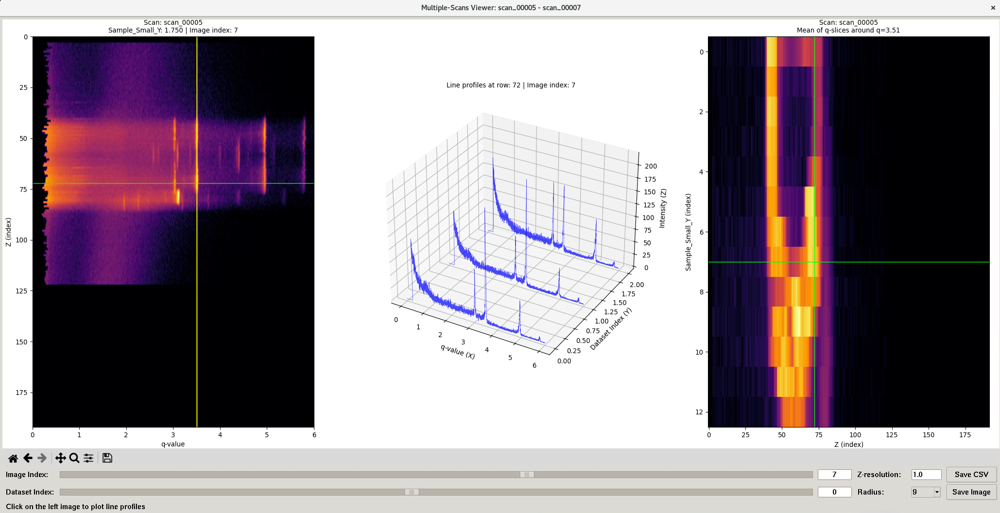
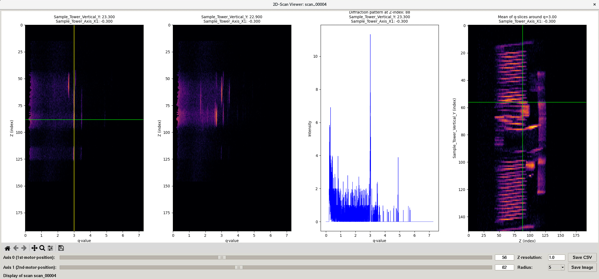
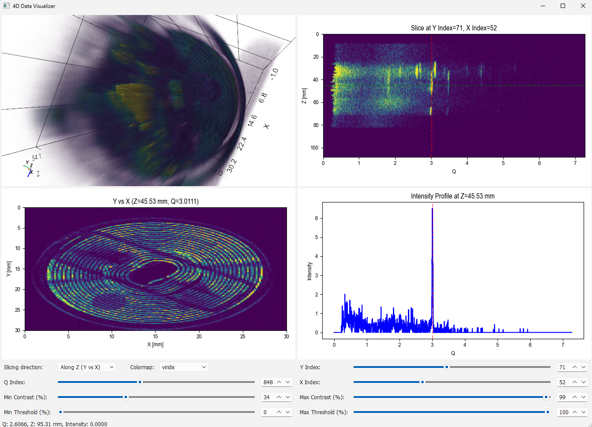

Currently, data acquired by the GeRM detector are saved as a series of TIFF files (raw data) 
and a JSON file (metadata), as shown below for 1D scan. The data acquisition script using PyEPICS is available [here](https://github.com/NSLS2/hex-acq-pyepics/tree/main/techniques/edxd).

For 2D scans, the row and column indices are included in the filenames. 
Data can also be saved in HDF5 format, but TIFF is currently used to make it easier for users to read the data locally.

To process the data, users run the process_data.py script to convert raw data into q-space data, then use 
different GUIs for visualization, depending on their needs.

These are Python scripts that users can run through the ScriptRunner GUI, which automatically renders  
command-line arguments as input fields, making the scripts easier to configure and execute.

Users can use eddt_viewer.py to visualize 1D scans of EDDT data.

Users can also use multiple_lines_viewer.py to visualize diffraction patterns from the same detector strip (row) at different scan positions.

or viewing multiple 1D-scans using multiple_scans_viewer.py

or viewing a 2D-scan using 2d_scan_viewer.py

The above viewer is designed for 2D cross-sectional visualization. To properly visualize a 2D scan, 
which produces a 4D dataset (a 2D image at each scan position), we first convert the TIFF files into a 4D HDF5 dataset. 
Downsampling may be necessary if the dataset exceeds the available RAM.

We then visualize the 4D dataset using a GUI built with PyVistaQt, Matplotlib, and PySide6. 
The workflow and GUI code are available in the 4D_data_viewer folder.

