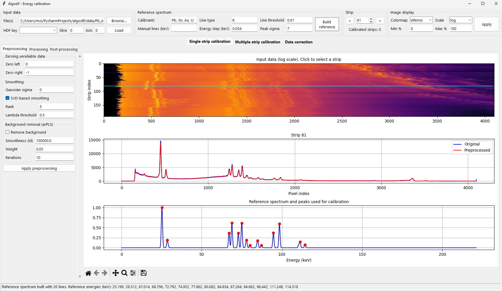
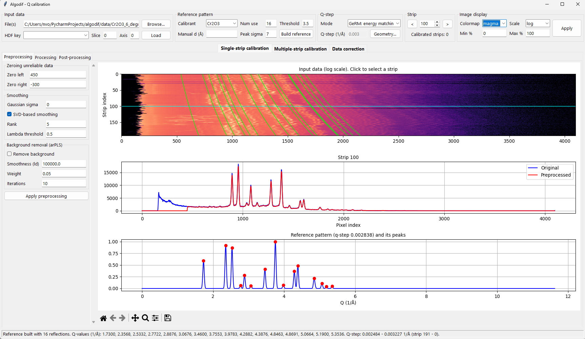

Energy- and q-calibration GUI (Python script) built using Tkinter and Matplotlib.

A unified GUI for energy and q calibration, built using PySide6 and PyQtGraph, 
is packaged and distributed as **EDCal** software: https://github.com/algodif/edcal