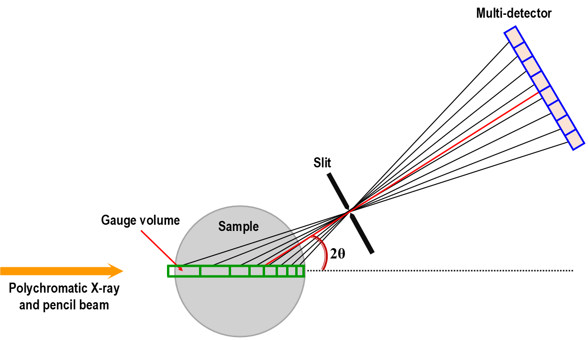
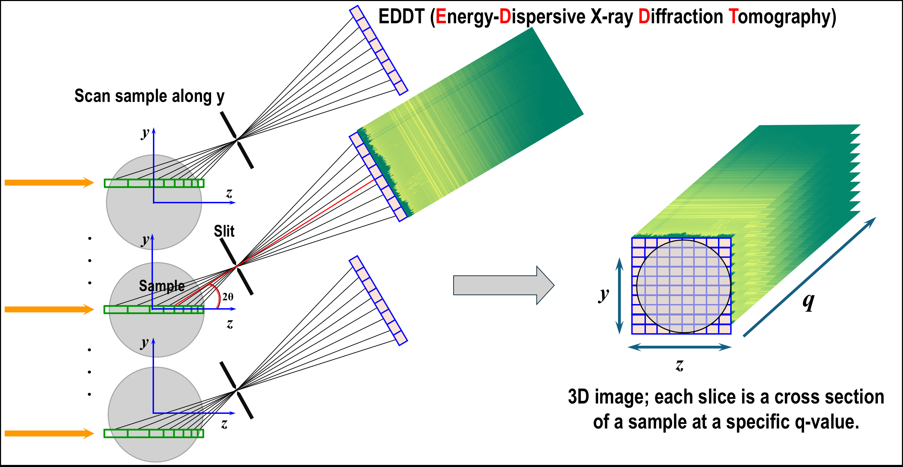
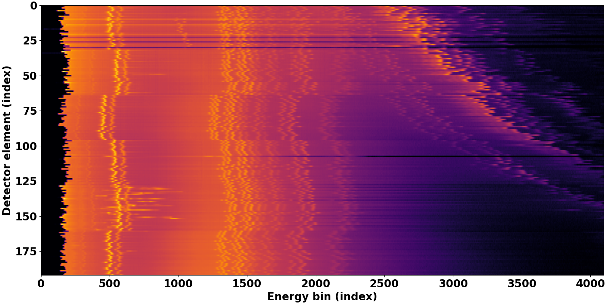
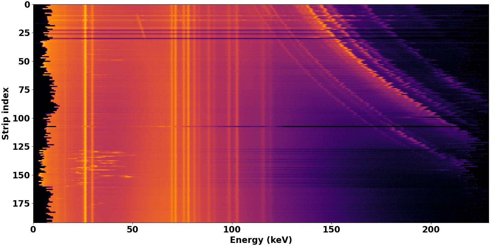
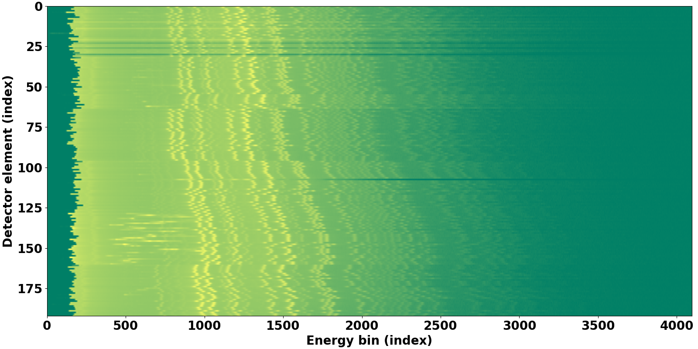
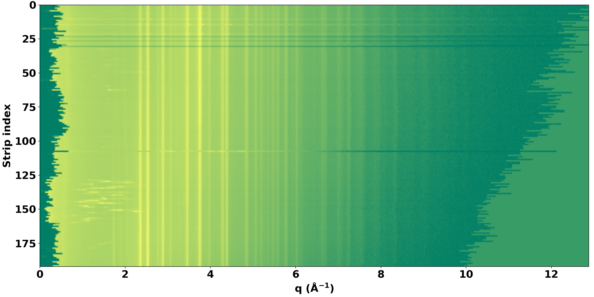
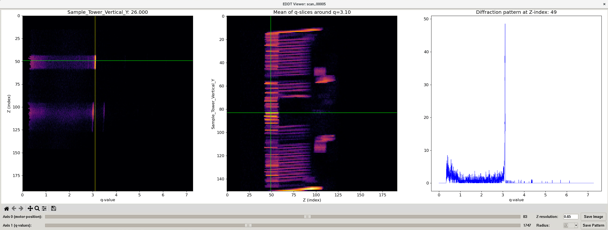

# Algodif
### Data processing (**ALGO**)rithms for (**DIF**)fraction-based X-ray techniques 

Methods and software for calibrating multi-element germanium energy-dispersive X-ray detectors, 
as well as for processing and visualizing data acquired using energy-dispersive X-ray 
diffraction tomography (EDDT) at hard X-ray synchrotron beamlines.  A detailed description 
is provided in our submitted paper: "Algorithms and Software Tools for Energy-Dispersive X-ray Diffraction Tomography,"  
Nghia T. Vo, Zhong Zhong, and Michael Drakopoulos.

Features
========
- Methods for peak detection and sub-pixel location.
- Methods for matching measured peaks to reference peaks
- Methods for energy calibration of the GeRM detector.
- Methods for Q-calibration of the GeRM detector.
- GUIs/CLIs for processing and visualizing EDDT data. 

Introduction
============

The multi-strip germanium energy-dispersive X-ray detector, developed by the 
detector group and combined with a pinhole geometry at the HEX beamline, NSLS-II, 
enables both spatial cross-sectional imaging of samples and detailed mapping of their 
crystal structures. This powerful technique has been routinely used at the beamline since 2023.

As illustrated, each detector element captures diffraction signals from a specific 
region of the sample, known as the gauge volume. The multi-strip detector array 
simultaneously records diffraction signals from different gauge volumes along 
the X-ray beam, effectively providing 1D spatially resolved measurements without 
tomographic reconstruction. By scanning the sample along the Y-axis, a 2D 
cross-sectional map can be constructed. Importantly, each pixel in this map 
contains a 1D diffraction pattern corresponding to a specific location within 
the sample. This is why the technique is called energy-dispersive X-ray diffraction 
tomography (EDDT): it enables direct tomographic imaging without computing 
required in conventional tomography. 

Calibration
===========

The detector requires frequent calibration for different experimental conditions due to 
variations in diffraction angles across gauge volumes and the complexity of the 
detector and readout electronics. Under polychromatic X-ray illumination, the 
detector can record both fluorescence and diffraction signals, depending on 
the sample and detector angle. So, two types of calibration are required: 
energy calibration and reciprocal-space (q) calibration.

Energy calibration
------------------

For detector energy calibration, the key idea is to maximize the fluorescence 
signal while minimizing the diffraction signal. We use a sample combined of thin foils 
of Sn, Pb, and Au to cover a wide energy range from low to high. A small amount of U is 
included to extend the calibration range beyond 110 keV. The results before and after energy 
calibration are shown below.

Q calibration
-------------

q-calibration, or reciprocal space calibration,is a major routine in the regular 
use of this detector at the HEX beamline. The detector needs to be calibrated when 
the theta angle changes or after a few days of use. In contrast to energy calibration, 
q-calibration requires minimizing fluorescence and maximizing diffraction signals. 
We tested several calibrants, including CeO2, Al2O3, Si, and LaB6, and found that Cr2O3 
is the best choice for minimizing fluorescence. The tilt of the diffraction lines across 
the detector strips reflects the variation in scattering angle across the detector.

The robustness and reliability of this routine depend critically on the peak detection 
and peak matching methods, which we have developed and refined over time. Details of these 
methods are provided in the referenced paper and the source code.

User interface software
-----------------------

We provide separate GUIs for different workflows and visualization tasks. Although combining 
everything into a single GUI may seem appealing, we chose a modular approach to simplify 
maintenance and accommodate the diverse needs of beamline operations. These tools (Python scripts) 
can be organized and launched through the [script-runner GUI](https://pypi.org/project/scriptrunner-gui/). 

Author
------
Nghia T. Vo - National Synchrotron Light Source II, Brookhaven National Lab, USA.

