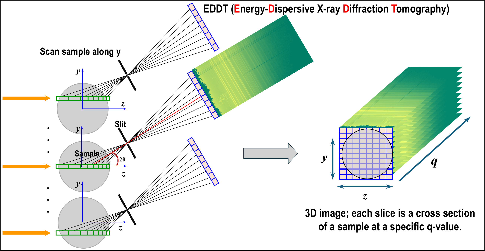

Algodif's documentation
=======================

**Data processing (ALGO)rithms for (DIF)fraction-based X-ray techniques.**

Algodif is an open-source Python package providing methods and software for
calibrating multi-element energy-dispersive X-ray (EDX) detectors, and for
processing and visualizing energy-dispersive X-ray diffraction tomography
(EDDT) data acquired at a hard X-ray synchrotron beamline. A detailed
description is provided in the paper :cite:`Vo:2026` (under review).

The core of this work addresses the following problem: given a list of
measured data points of unknown unit, how to map them onto a list of reference
points of known unit. The challenge is that the number of measured data points
is not the same as the number of reference points, so there are many local
minima in the mapping transformation. For X-ray diffraction techniques, this
is the problem of calibrating an instrument, in a robust and automated fashion,
using the diffraction pattern or fluorescence spectrum of a known calibrant.

Although the work was initially aimed at calibrating the instrument (the GeRM
detector) of the HEX beamline, NSLS-II, the methods and software can be applied
to other instruments given standard diffraction patterns or spectra. The
specific GeRM geometry is helpful for determining initial guesses of the
optimization methods. However, the algorithms in the software are not
restricted to the GeRM detector.

|

**Features:**

-   Methods for peak detection and sub-pixel location.
-   Methods for matching measured peaks to reference peaks.
-   Methods for energy calibration of an EDX detector.
-   Methods for q-calibration of an EDX detector and the GeRM detector.
-   GUIs/CLIs for processing and visualizing EDDT data from the GeRM detector.

**Source code:** https://github.com/algodif/algodif

**Examples:** https://github.com/algodif/algodif/tree/main/examples

**Author:** Nghia T. Vo - NSLS-II, Brookhaven National Laboratory, US.

**Keywords:** Energy-dispersive X-ray diffraction, EDX detector calibration,
energy calibration, q-calibration, peak detection, peak matching, GeRM detector,
tomography.

Contents
========

.. toctree::
    :maxdepth: 3
    :numbered:

    install
    tutorials
    usage
    api
    credit
