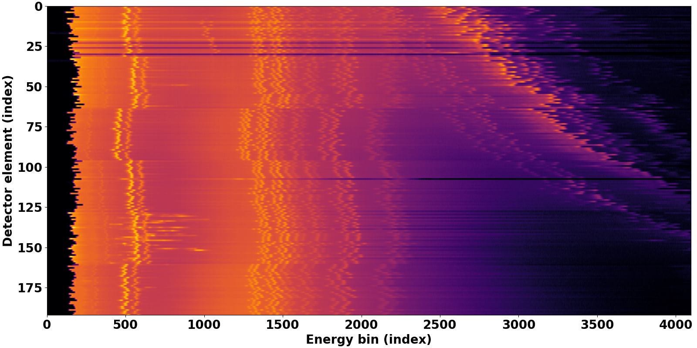
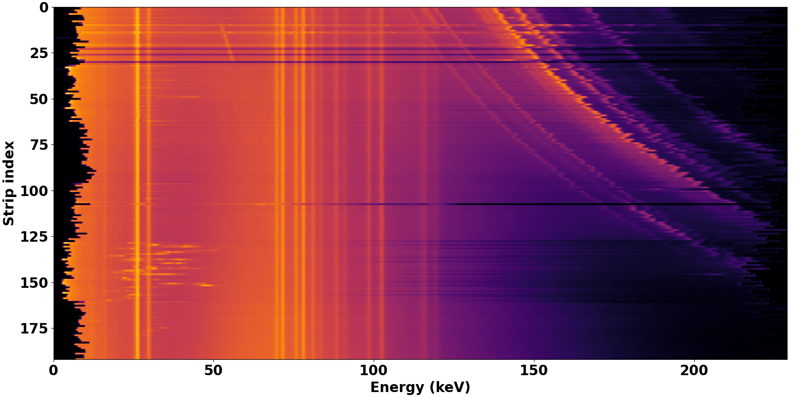
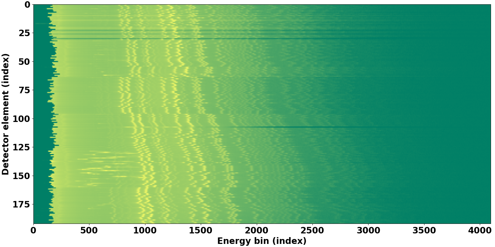
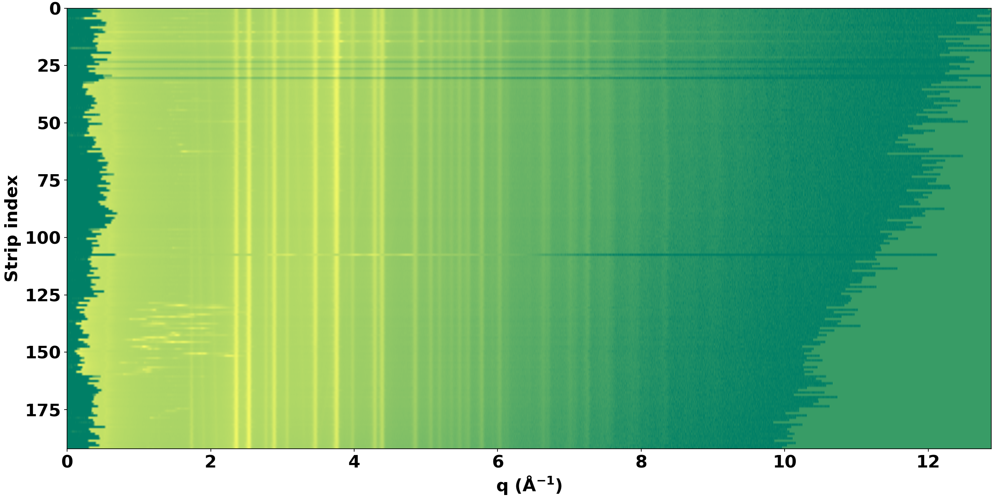

.. _calibration:

Calibration
===========

The detector requires frequent calibration for different experimental
conditions due to variations in diffraction angles across gauge volumes and
the complexity of the detector and readout electronics. Under polychromatic
X-ray illumination, the detector can record both fluorescence and diffraction
signals, depending on the sample and detector angle. So, two types of
calibration are required: energy calibration and reciprocal-space (q)
calibration.

The robustness and reliability of these routines depend critically on the
peak detection and peak matching methods, which have been developed and
refined over time. Details of these methods are provided in :cite:`Vo:2026`
and in the :ref:`API reference <api>`.

Energy calibration
------------------

For detector energy calibration, the key idea is to maximize the fluorescence
signal while minimizing the diffraction signal. A sample composed of thin foils
of Sn, Pb, and Au is used to cover a wide energy range from low to high. A
small amount of U is included to extend the calibration range beyond 110 keV.
The results before and after energy calibration are shown below.

    Fluorescence spectra recorded by the detector strips before energy
    calibration.

    Fluorescence spectra after energy calibration.

q-calibration
-------------

q-calibration, or reciprocal-space calibration, is a major routine in the
regular use of this detector at the HEX beamline. The detector needs to be
calibrated when the theta angle changes or after a few days of use. In contrast
to energy calibration, q-calibration requires minimizing fluorescence and
maximizing diffraction signals. Several calibrants were tested, including
CeO\ :sub:`2`, Al\ :sub:`2`\ O\ :sub:`3`, Si, and LaB\ :sub:`6`, and
Cr\ :sub:`2`\ O\ :sub:`3` was found to be the best choice for minimizing
fluorescence. The tilt of the diffraction lines across the detector strips
reflects the variation in scattering angle across the detector.

    Diffraction patterns of Cr\ :sub:`2`\ O\ :sub:`3` before q-calibration.

    Diffraction patterns after q-calibration.
