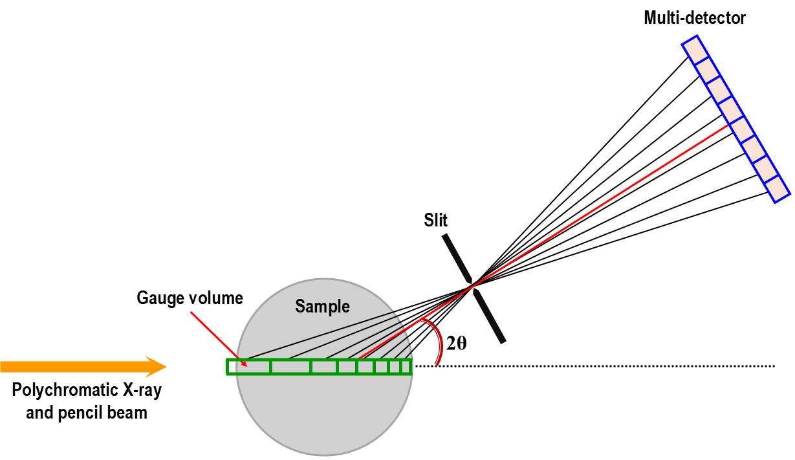
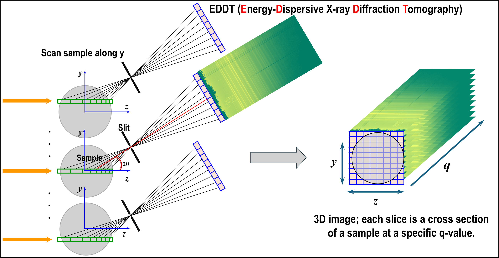

.. _eddt_technique:

Energy-dispersive X-ray diffraction tomography
==============================================

The multi-strip germanium energy-dispersive X-ray detector (GeRM), developed by
the detector group and combined with a pinhole geometry at the HEX beamline,
NSLS-II, enables both spatial cross-sectional imaging of samples and detailed
mapping of their crystal structures. This technique has been routinely used at
the beamline since 2023.

    Geometry of the energy-dispersive X-ray diffraction setup using the
    multi-strip GeRM detector.

As illustrated, each detector element captures diffraction signals from a
specific region of the sample, known as the gauge volume. The multi-strip
detector array simultaneously records diffraction signals from different gauge
volumes along the X-ray beam, effectively providing 1D spatially resolved
measurements without tomographic reconstruction. By scanning the sample along
the Y-axis, a 2D cross-sectional map can be constructed. Importantly, each
pixel in this map contains a 1D diffraction pattern corresponding to a specific
location within the sample. This is why the technique is called
energy-dispersive X-ray diffraction tomography (EDDT): it enables direct
tomographic imaging without the computation required in conventional
tomography.

    Principle of the EDDT technique.
