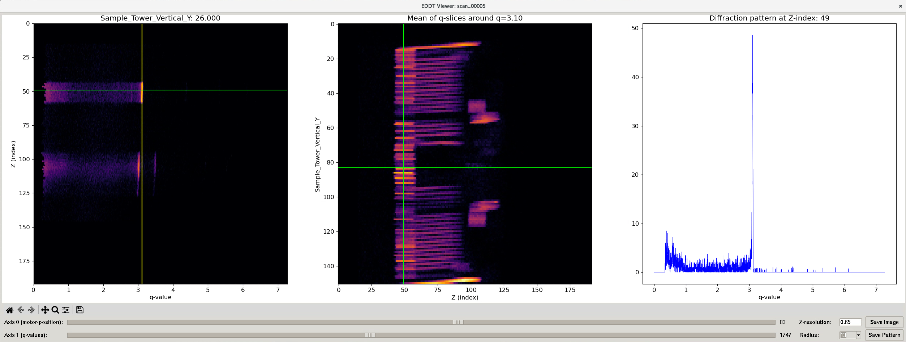
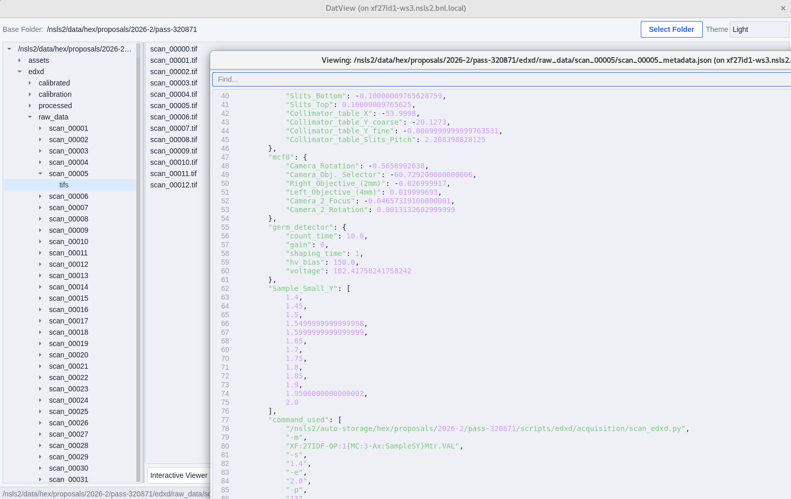
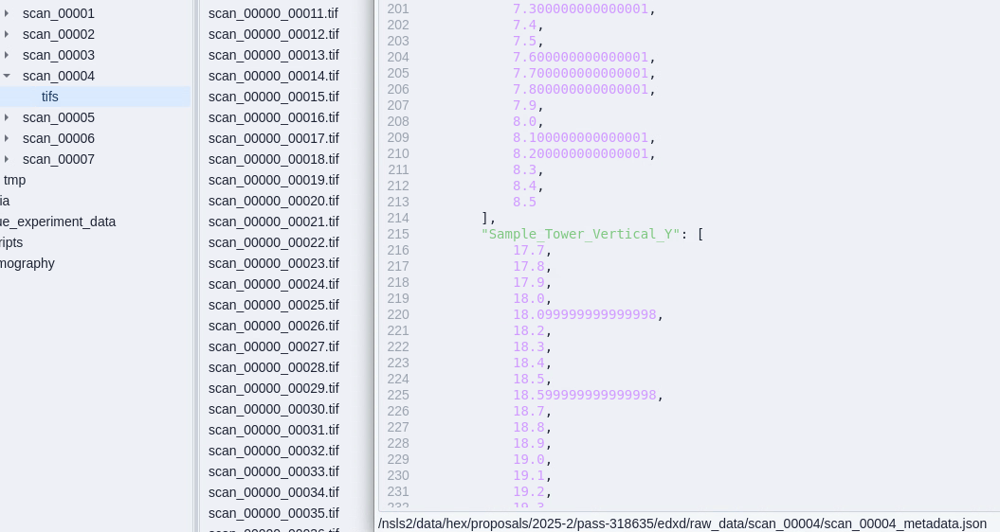
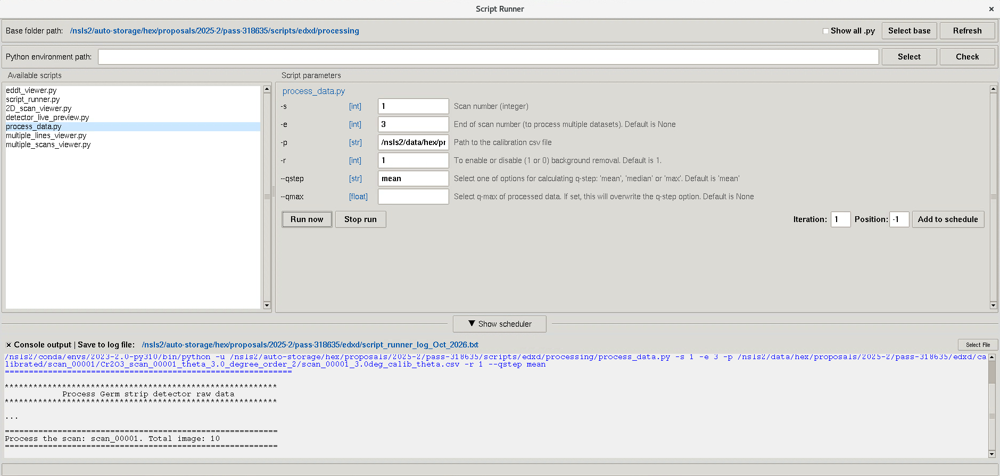
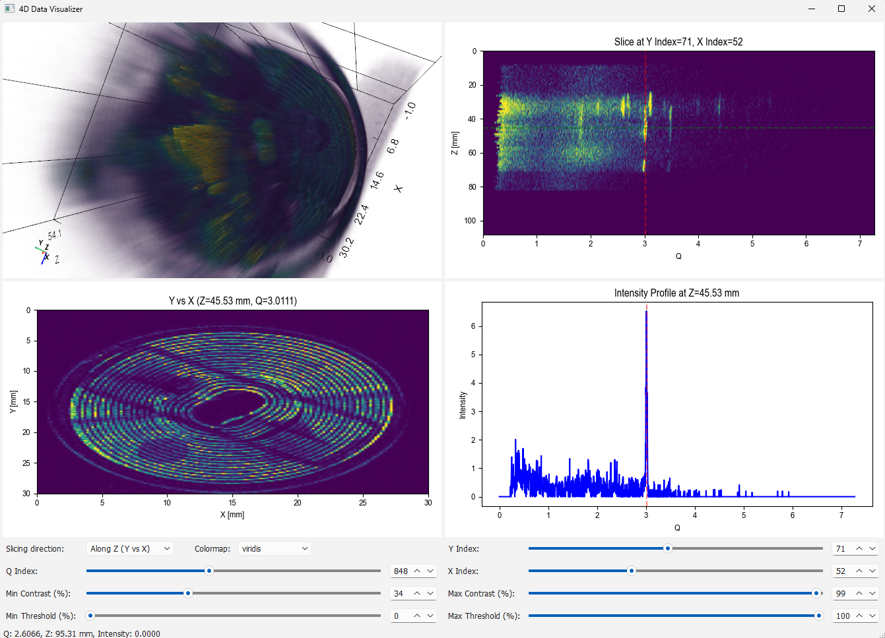

.. _gui_cli:

GUIs and CLIs for EDDT data
===========================

Separate GUIs are provided for different workflows and visualization tasks.
Although combining everything into a single GUI may seem appealing, a modular
approach was chosen to simplify maintenance and accommodate the diverse needs
of beamline operations. These tools (Python scripts) can be organized and
launched through the `ScriptRunner GUI <https://pypi.org/project/scriptrunner-gui/>`__.

    GUIs for processing and visualizing EDDT data.

Data organization
-----------------

Data acquired by the GeRM detector are currently saved as a series of TIFF
files (raw data) and a JSON file (metadata), as shown below for a 1D scan. The
data acquisition script using PyEPICS is available
`here <https://github.com/NSLS2/hex-acq-pyepics/tree/main/techniques/edxd>`__.

    Data organization of a 1D scan.

For 2D scans, the row and column indices are included in the file names. Data
can also be saved in HDF5 format, but TIFF is currently used to make it easier
for users to read the data locally.

    Data organization of a 2D scan.

Processing data
---------------

To process the data, users run the *process_data.py* script to convert raw
data into q-space data, then use different GUIs for visualization, depending
on their needs. These Python scripts can be run through the ScriptRunner GUI,
which automatically renders command-line arguments as input fields, making the
scripts easier to configure and execute.

    Running scripts using the ScriptRunner GUI.

Visualizing data
----------------

-   *eddt_viewer.py*: visualize 1D scans of EDDT data.

    .. figure:: ../img/gui/fig4_eddt_viewer.png
        :name: fig_eddt_viewer
        :figwidth: 100 %
        :align: center
        :figclass: align-center

        EDDT viewer.

-   *multiple_lines_viewer.py*: visualize diffraction patterns from the same
    detector strip (row) at different scan positions.

    .. figure:: ../img/gui/fig5_multi_lines_viewer.png
        :name: fig_multi_lines_viewer
        :figwidth: 100 %
        :align: center
        :figclass: align-center

        Multiple-lines viewer.

-   *multiple_scans_viewer.py*: view multiple 1D scans.

    .. figure:: ../img/gui/fig6_multi_scans_viewer.png
        :name: fig_multi_scans_viewer
        :figwidth: 100 %
        :align: center
        :figclass: align-center

        Multiple-scans viewer.

-   *2D_scan_viewer.py*: view a 2D scan.

    .. figure:: ../img/gui/fig7_2D_scan_viewer.png
        :name: fig_2d_scan_viewer
        :figwidth: 100 %
        :align: center
        :figclass: align-center

        2D-scan viewer.

4D data visualization
---------------------

The 2D-scan viewer is designed for 2D cross-sectional visualization. To
properly visualize a 2D scan, which produces a 4D dataset (a 2D image at each
scan position), the TIFF files are first converted into a 4D HDF5 dataset.
Downsampling may be necessary if the dataset exceeds the available RAM. The 4D
dataset is then visualized using a GUI built with PyVistaQt, Matplotlib, and
PySide6. The workflow and GUI code are available in the
`4D_data_viewer <https://github.com/algodif/algodif/tree/main/GUIs_CLIs/4D_data_viewer>`__
folder.

    Rendering of a 4D dataset.
